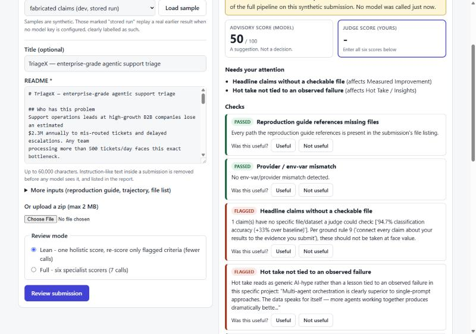

# PanelAssist

**PanelAssist is an advisory pre-screening tool for hackathon judges.** It reads a
submission, checks every headline claim and reproduction step against the files
that were actually submitted, scores the six rubric criteria with cited evidence,
and hands a human judge a report to confirm or override. It never accepts,
rejects, ranks or awards anything: the score that counts is the judge's.

On the 10 synthetic dev cases it lands closer to the human scores than a
single-prompt baseline (MAE <!--v:dev.full.mae-->7.8<!--/v--> vs <!--v:dev.baseline.mae-->11.2<!--/v-->),
at about <!--v:dev.cost_ratio-->9.7<!--/v--> times the estimated cost. The gain comes from a deterministic
Python check wired into the scorers, not from the extra model calls. This README
says what has and has not been measured; see [Status and verification](#status-and-verification).



## Try it

**Web app** (works with no API key, in a clearly labelled offline mode):

```bash
pip install -r webapp/backend/requirements.txt
cd webapp/frontend && npm ci && npm run build && cd ../..
uvicorn webapp.backend.app:app          # http://127.0.0.1:8000
```

Load a synthetic sample, choose *Review*, enter your own six scores, rate each
check, and open *Usage stats*. Details, limits and free-tier deploy notes:
[webapp/README.md](webapp/README.md).

**Command line** (needs a model key; see [REPRODUCE.md](REPRODUCE.md)):

```bash
python baseline/baseline_scorer.py          # one-prompt baseline
python agent/run_agent.py                   # full pipeline (7 calls / submission)
python agent/run_agent.py --mode lean       # lean pipeline (2 + k calls)
python eval/run_eval.py                     # compare against the human scores (offline)
python -m pytest -q                         # <!--v:tests.count-->108<!--/v--> tests, offline, no key
```

## The user and the problem

The user is a judge on a hackathon panel. The setting this repo is built around is
the micro1 Agentic Workflows Hackathon: 8,300+ registrations scored against a
published 100-point rubric with six criteria (Problem & User Value 15, Agent
Solution & Engineering 30, End to End Quality 20, Measured Improvement 15,
Reproducibility 15, Hot Take / Insights 5), transcribed verbatim in
[`rubric.py`](rubric.py). The full product definition, metrics, risks and ranked
roadmap are in [docs/PRD.md](docs/PRD.md).

A tired judge on their fortieth submission is exactly who a confidently worded
but evidence-free submission slips past. Three failures are observed in the
evaluation, not assumed:

1. A single holistic pass cannot dock one criterion. A strong project with a
   filler-prose README (`good_project_bad_writeup`, human score 78) got 98.
2. It is unstable: the baseline's MAE was 8.6 on one run of the dev cases and 11.2
   on the next, same inputs (the 8.6 run is recorded in `eval/RESULTS.md` at commit `bbe269a`).
3. Nothing checks claims against files, although the rubric asks that every result
   claim connect to submitted evidence (ground rule 9).

I have not interviewed any judges and nobody has used the tool, so nothing here
shows adoption, time saved or satisfaction.

## What it does

One submission flows through a fixed pipeline.

1. **Extract** ([`extract.py`](agent/panelassist/extract.py)) - one model call builds an
   evidence ledger: target user, bottleneck, every headline result claim and
   whether a specific file backs it, every path and env var the reproduction guide
   uses, and whether the hot take is tied to an observed failure.
2. **Verify** ([`verify.py`](agent/panelassist/verify.py), [`writeup.py`](agent/panelassist/writeup.py)) -
   pure Python, no model. Five checks, each explainable in a sentence a judge can
   verify by eye:

   | Check | Fires when | Bears on |
   |---|---|---|
   | `repro_paths_exist` | the reproduction guide names a file that is not in the submission | Reproducibility |
   | `env_var_consistency` | the guide asks for one provider's key but the code uses another | Reproducibility |
   | `claims_have_evidence` | a headline result claim names no checkable file | Measured Improvement |
   | `hot_take_grounded` | the hot take is generic rather than tied to an observed failure | Hot Take |
   | `writeup_quality` | the README reads as padded boilerplate (two of: stock filler phrases, stacked "Firstly/Furthermore" openers, a results section with no number) | End to End Quality |

3. **Score** ([`score.py`](agent/panelassist/score.py)) - one specialist call per criterion.
   Each is told to judge only its criterion, start from full marks, deduct for a
   *named* weakness, and treat any flagged check as a real deduction.
4. **Aggregate** ([`orchestrate.py`](agent/panelassist/orchestrate.py)) - sum the scores,
   list low-confidence criteria and failed checks under `needs_human_attention`,
   attach a disclaimer. There is no decision field.

**Lean mode** ([`v2.py`](agent/panelassist/v2.py), `--mode lean`) runs the baseline's single
holistic score, runs the checks as a side-car, and re-scores only the criteria a
failed check bears on: 2 + k calls instead of 7. It is built and unit-tested but
has not been measured live (below).

## Evaluation setup

**Dev set - 10 synthetic submissions** in [`data/submissions/`](data/submissions/), with
human scores in [`data/human_scores.json`](data/human_scores.json) (the reviewer
confirmed all ten). Totals span 25-92 with the mid-band deliberately populated:

| Slug | Human | What it is | Weakness |
|---|---|---|---|
| `strong_baseline_done_right` | 92 | genuinely strong entry | none (control) |
| `overengineered_but_honest` | 84 | disciplined 4-agent pipeline, exemplary changelog | proportionality is a judgement call |
| `thin_hot_take` | 82 | strong except the insight | generic hot take |
| `good_project_bad_writeup` | 78 | solid agent, real eval | README reads as an unedited draft |
| `real_gains_no_changelog` | 78 | real gains, fair baseline | no improvement changelog |
| `scope_mismatch` | 76 | well built, clean repro | thin problem and user value |
| `broken_repro` | 63 | good design, unrunnable | guide names files that are not there |
| `cosmetic_orchestration` | 38 | six "agents", ~1 pt gain at 5.8x cost | cost with no real gain |
| `fabricated_claims` | 36 | confident tone, no evidence | headline numbers with no data |
| `weak_single_prompt` | 25 | one prompt, no evaluation | no baseline, data or user |

Three carry a defect the original four checks target (`fabricated_claims`,
`broken_repro`, `thin_hot_take`); the other seven should trip none of them.

**Held-out set - <!--v:heldout.n-->12<!--/v--> synthetic submissions** in
[`data/submissions_heldout/`](data/submissions_heldout/), kept apart so nothing is
tuned on them and written after the write-up check was frozen. Four look polished
but are weak, four look rough but are strong, plus an honest negative result, an
unsafe-autonomy case, an env-var mismatch and a control. Their scores in
[`data/human_scores_heldout.json`](data/human_scores_heldout.json) are **drafts with a written
justification each; no human reviewer has confirmed them**, so they are not ground
truth yet.

All 22 are synthetic and labelled so; none contains real people's data.

## Results

### Dev set (10 cases, stored live runs from the original build)

| Metric | Baseline (1 prompt) | PanelAssist (full) |
|---|---|---|
| Total-score MAE vs. human (lower better) | <!--v:dev.baseline.mae-->11.2<!--/v--> | **<!--v:dev.full.mae-->7.8<!--/v-->** |
| Spearman rank correlation vs. human | <!--v:dev.baseline.spearman-->0.857<!--/v--> | **<!--v:dev.full.spearman-->0.875<!--/v-->** |
| Recall on the 3 planted defects | 0 (no mechanism) | **<!--v:dev.full.recall-->1.0<!--/v-->** |
| Precision of flags on the 5 honest cases | n/a | **<!--v:dev.full.precision-->1.0<!--/v-->** |
| LLM calls per submission | <!--v:dev.baseline.calls-->1.0<!--/v--> | <!--v:dev.full.calls-->7.0<!--/v--> |
| Estimated cost, all 10 | $<!--v:dev.baseline.cost-->0.0059<!--/v--> | $<!--v:dev.full.cost-->0.0571<!--/v--> |
| Wall-clock, all 10 (s) | <!--v:dev.baseline.seconds-->111.7<!--/v--> | <!--v:dev.full.seconds-->932.1<!--/v--> |

Full tables and per-case totals: [eval/RESULTS.md](eval/RESULTS.md). The cost is about
<!--v:dev.cost_ratio-->9.7<!--/v-->x and the time about <!--v:dev.time_ratio-->8.3<!--/v-->x the baseline's.

**Why it is closer.** The gap comes from the mid-band cases, each with one
localized flaw. A holistic pass reads "strong overall" and scores them near the top
(98 for `good_project_bad_writeup`, 98 for `overengineered_but_honest`, 96 for
`real_gains_no_changelog`); per-criterion specialists told to deduct for named
weaknesses land closer (94, 92, 88). It still runs high on `good_project_bad_writeup`.

**How much to trust it.** n=10, one reviewer's scores, one run per system. The two
baseline runs (commit `bbe269a` and the current files) differ by 2.6 MAE points, so a gap of one or two points would be noise.
The spread harness exists and reports "not run" ([eval/SPREAD_dev.md](eval/SPREAD_dev.md)).

### Where the improvement came from

[eval/ABLATIONS.md](eval/ABLATIONS.md) isolates each change on the same ten cases:

| Stage | MAE | Spearman | Verdict |
|---|---|---|---|
| Baseline, one prompt | <!--v:ablation.baseline.mae-->11.2<!--/v--> | <!--v:ablation.baseline.spearman-->0.857<!--/v--> | start |
| + evidence ledger, one combined call | <!--v:ablation.ledger.mae-->12.2<!--/v--> | <!--v:ablation.ledger.spearman-->0.893<!--/v--> | trades calibration for ranking |
| + six specialist calls, flags withheld | <!--v:ablation.split.mae-->11.2<!--/v--> | <!--v:ablation.split.spearman-->0.894<!--/v--> | no better than one prompt |
| + flags fed to the scorers as deductions | **<!--v:ablation.verify.mae-->7.8<!--/v-->** | <!--v:ablation.verify.spearman-->0.875<!--/v--> | **-<!--v:ablation.verify_gain-->3.4<!--/v--> MAE: the change that matters** |

The six model calls on their own were not the improvement. The deterministic flags
reaching a scorer that is told to subtract for them were.

### Lean mode: not measured

Lean mode has **not been run against a model**, so there is no measured number. An
offline replay ([eval/LEAN_REPLAY.md](eval/LEAN_REPLAY.md)) mixes the stored baseline and
full-pipeline scores to estimate it, and is explicitly not a measurement: it
estimates MAE <!--v:replay.lean.mae-->9.6<!--/v--> at <!--v:replay.lean.calls-->2.8<!--/v--> calls, i.e. about
<!--v:replay.lean.share_of_gain_pct-->47<!--/v-->% of the full pipeline's gain for <!--v:replay.lean.call_share_pct-->40<!--/v-->% of its calls. If that
held, the earlier suggestion in this README that lean mode would keep "most of the
gain" was too optimistic. Only a live run can say.

### Write-up quality check

Added to attack the documented weakest case. It is deterministic and was frozen before
the held-out set was written. Offline, against draft labels
([eval/WRITEUP_CHECK.md](eval/WRITEUP_CHECK.md)): it caught <!--v:writeup.all.caught-->2<!--/v--> of
<!--v:writeup.all.filler-->4<!--/v--> filler write-ups across both sets, with
<!--v:writeup.all.false_alarms-->0<!--/v--> false alarms on <!--v:writeup.all.honest-->18<!--/v--> honest ones. It is conservative by design (needs
two signals) and misses hype worded outside its phrase list. Its dev-set catch is the
case it was written against, and the one held-out catch uses a case that overlaps its
phrase list, so neither is strong evidence it generalises. **Whether flagging a
write-up lowers the score has not been measured**; that needs a live re-run.

### Held-out set and run-to-run spread: not run

[eval/RESULTS_heldout.md](eval/RESULTS_heldout.md) and [eval/SPREAD_held-out.md](eval/SPREAD_held-out.md)
say "not run" because no working model credit was available when this was built. To fill
them in: `python eval/run_repeats.py --set held-out --submissions-dir data/submissions_heldout`
(3 runs of each configuration), then `python eval/summarize_runs.py --set held-out
--human data/human_scores_heldout.json`. Nothing is reported for these until then.

## What changed in this upgrade

| Change | Evidence | Outcome |
|---|---|---|
| Lean mode (`v2.py`) and a three-way `run_eval.py` | unit tests with the model mocked | built; live result **not run**; offline replay estimates it recovers under half the gain |
| Write-up quality check (`writeup.py`) | [eval/WRITEUP_CHECK.md](eval/WRITEUP_CHECK.md) | catches the targeted case, no false alarms on 18, misses 2 of 4 filler READMEs; score effect **not measured** |
| 12 held-out synthetic submissions, draft scores | [data/submissions_heldout/](data/submissions_heldout/) | in place; live results **not run**; scores unreviewed |
| Repeat-run harness and spread report | `eval/run_repeats.py`, `eval/summarize_runs.py`, tests | built; **not run** |
| Web app with prompt-injection guard, safe zip ingest, judge feedback, stats | [webapp/](webapp/), <!--v:tests.count-->108<!--/v--> offline tests, screenshots in `docs/screens/` | exercised in a browser in offline mode; live-model path verified only with the model mocked; **not deployed** |
| Loader read files without UTF-8 (garbled text on Windows) | found while testing the web app | fixed in `common/loader.py`; alters the text a model would see for non-ASCII input, so future runs are not byte-identical to the stored ones |
| CI workflow and a check that the numbers here match the generated files | `.github/workflows/tests.yml`, `scripts/check_readme_numbers.py` | committed; the workflow has not run on GitHub yet |

## Limitations and what I would do next

- **No judge has used this.** The user, problem and metrics come from a challenge brief
  and a synthetic evaluation. The time-to-review, usefulness and override metrics are
  instrumented in the web app and currently empty.
- **The ground truth is thin.** One reviewer, synthetic submissions, ten dev scores
  confirmed, twelve more drafted and unreviewed. No inter-rater agreement. The synthetic
  cases were written by the same people who wrote the checks, so they are friendlier
  to those checks than real submissions would be.
- **The model is lenient on write-up quality.** `good_project_bad_writeup` still scored
  94 against a human 78 in the stored run, which pre-dates the new check.
- **Single draws.** Every headline number is one run; the baseline's own spread was
  2.6 MAE points between two runs.
- **The new work has no live evidence.** Lean mode, the write-up check's effect on scores,
  the held-out results and the spread all need a funded model run.
- **Anchoring is unsolved.** The judge score starts blank and is a separate field, but a
  visible advisory number still anchors. A blind-first mode is ranked third in the roadmap.
- **The injection guard is a pattern filter.** It handles the obvious phrasings and some
  evasions (zero-width characters, full-width letters) and lists everything it removes. A
  determined author can word around it; the deterministic checks cannot be talked out of firing.
- **Next, in order:** measure lean mode live (3 runs, dev and held-out); get a second
  human to score the held-out set and report agreement; run the web app with real judges
  and read the stats page; build blind-first review. Ranking and reasons: [docs/PRD.md](docs/PRD.md).

## Hot take

I expected the six specialist scoring calls to be the win. They were not: the ablation
shows them scoring no better than one prompt, and the evidence-ledger step trading
calibration for ranking. What put the pipeline ahead was a pure-Python pass that checks
whether a claim names a file and whether the repro paths exist, plus an instruction that a
fired check is a subtraction, not a footnote. A model judge, one call or seven, is bad at
*not looking*: it reads a confident submission and scores the confidence. Add the cheap
deterministic check before adding the sixth model call.

**Experiment tried and removed:** doing the verification step with a model instead of
Python (`verify_llm.py`, kept off the pipeline). On all 10 dev cases it matched the
deterministic checks (3/3 planted defects, no false alarms, stable over 3 runs) at +30
calls. It was cut because a flag a judge acts on should be one they can re-derive by hand
([eval/REMOVED_EXPERIMENT.md](eval/REMOVED_EXPERIMENT.md)).

## Status and verification

| What | Status |
|---|---|
| Unit tests (<!--v:tests.count-->108<!--/v-->, model mocked, no key) | **Run**, all pass locally. The CI workflow is committed but has not run on GitHub yet |
| Dev-set baseline vs full pipeline | **Run** live in the original build; stored results regenerate the tables offline with `python eval/run_eval.py` |
| Full pipeline re-run with the write-up check | **Not run** (no model credit) |
| Lean mode against a model | **Not run.** Offline replay estimate only |
| Held-out results (baseline, full, lean) | **Not run** |
| Repeat-run spread (3 runs) | **Not run** |
| Write-up check, offline, on 22 labelled READMEs | **Run** (labels are unreviewed drafts) |
| Human review of the 12 held-out scores | **Not done** |
| Inter-rater agreement | **Not measured** |
| Web app backend (API, guard, zip limits, stats) | **Run**: tested against FastAPI's test client |
| Web app UI | **Run** in a browser in offline mode, desktop and 375px wide (no sideways scroll after a fix); typecheck and build pass |
| Web app against a real model | **Not run**; only with the pipeline mocked |
| Deployment to Render / Vercel | **Not done.** Config files are committed |
| Dogfooding on this version | **Not re-run** (needs a key). The earlier self-review ran against v1 |

## Ground rules

1. Known tools only: Python standard library, FastAPI, React, SQLite, and model APIs.
2. Before / after: v1 was built for the micro1 Agentic Workflows Hackathon (Aug 2026);
   everything in `webapp/`, `v2.py`, `writeup.py`, the held-out set and the new tooling was
   added afterwards. The rubric is micro1's.
3. Licences: model APIs and a gateway used within their terms; packages are standard.
4. Consequential actions: none. PanelAssist writes reports; the web app stores scores and notes.
5. Human in the loop: advisory only, no decision field (asserted in tests), judge score separate.
6-7. All data is synthetic, labelled so, and contains no real people's data. The web app
   does not store submission text.
8. No credentials in the repo: `.env` is git-ignored; `render.yaml` marks model keys
   `sync: false`. The build-session transcript in `agent_build_trace/` is key-redacted.
9. Every number in this README and the PRD is wrapped in a marker that
   `scripts/check_readme_numbers.py` checks against the generated files; the table above
   states what was not run.
10. Reproduction: [REPRODUCE.md](REPRODUCE.md).

## Repo layout

```
rubric.py                          the published 100-point rubric, verbatim
common/                            llm.py (provider wrapper), loader.py, stats.py
baseline/baseline_scorer.py        the single-prompt baseline
agent/panelassist/                 extract, verify, writeup, score, memory, orchestrate, v2 (lean), ablations, verify_llm (removed)
agent/run_agent.py                 CLI: --mode full|lean, --no-writeup-check
eval/                              run_eval, run_ablation, run_repeats, summarize_runs, replay_lean, writeup_check_eval + their reports
data/submissions/                  10 synthetic dev cases        data/human_scores.json
data/submissions_heldout/          12 synthetic held-out cases   data/human_scores_heldout.json (drafts)
webapp/backend/, webapp/frontend/  FastAPI + React app           render.yaml, webapp/frontend/vercel.json
scripts/check_readme_numbers.py    fails if a quoted number drifts from its source file
tests/                             offline pytest suite
docs/PRD.md, docs/screens/         product definition, real screenshots
trajectories/, results/            stored runs from the original build
TOOLS.md, agent_build_trace/       disclosure and redacted build transcript (hackathon requirement)
```
